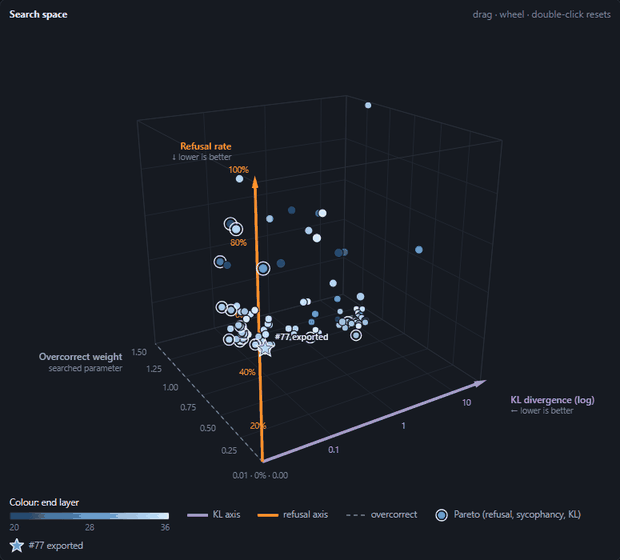
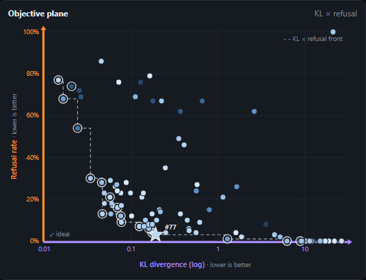
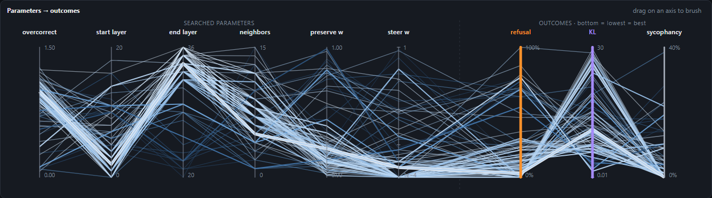
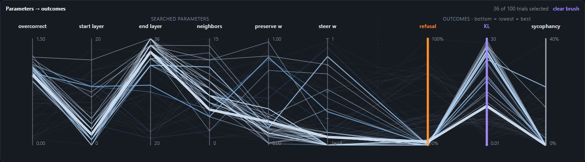

# K2-Horizon-7B-Uno heretic (uncensored + de-sycophantized)

**Weights and model card: [Flakily6416/K2-Horizon-7B-Uno-heretic on Hugging Face](https://huggingface.co/Flakily6416/K2-Horizon-7B-Uno-heretic).** This repository holds everything except the weights: the search data, the interactive trace ([hosted page](https://mr-september.github.io/K2-Horizon-7B-Uno-heretic/)), the config and the Optuna study.

Behavior-modified version of [hermitdave/K2-Horizon-7B-Uno-merged](https://huggingface.co/hermitdave/K2-Horizon-7B-Uno-merged) (merged LoRA of [IFM/K2-Horizon-7B-Uno](https://huggingface.co/IFM/K2-Horizon-7B-Uno)), produced with [Heretic 2.x](https://github.com/p-e-w/heretic) using the Arbitrary-Rank Ablation (ARA) modifier. LoRA merged into full bf16 weights — runs as a standard autoregressive model, same oMLX/MLX notes as the source card apply.

## What was changed

A single combined ARA pass co-optimizing three objectives over 100 Optuna trials:

| Objective | Dataset | Baseline (source model) | This model |
| --- | --- | --- | --- |
| Refusal rate | `mlabonne/harmful_behaviors` test[:100] | 77/100 | **3/100** |
| Sycophancy rate | `UnstableLlama/praise` (flattering system prompt), 78 held-out prompts | up to 22/78 | **0/78** |
| KL divergence vs source | `mlabonne/harmless_alpaca` test[:100] | — | **0.191** |

Selected from the 18-point Pareto front by behavior-per-KL: the only 0/0 trial cost KL 8.9 (~46× the tax for 3 keyword points). Evaluation used the model's chat template with `reasoning_effort=medium` (the shipped template keeps the original `high` default, untouched); Heretic's CoT-skip was configured for the `<ifm|think*>` tag family so scoring evaluated answers, not thinking blocks.

Modification targets `self_attn.o_proj` and `mlp.down_proj` in the learned layer range only — sampled non-targeted tensors (layernorms, `q_proj`, `gate_proj`) are bit-identical to the source model.

## Search trace

All 100 Optuna trials, from [`trials.json`](trials.json). Interactive version (rotate, brush, pin): [hosted page](https://mr-september.github.io/K2-Horizon-7B-Uno-heretic/).

[](https://mr-september.github.io/K2-Horizon-7B-Uno-heretic/)

Axes: KL divergence (log) and refusal rate are the optimisation targets (lower is better); the third axis and colour carry searched parameters. Ringed points are the 18-trial Pareto set over refusal, sycophancy and KL; the star is the exported trial #77.



The dashed staircase is the 14-trial front in those two objectives only.



The same view brushed to refusal ≤ 5% (36 trials): high overcorrect weight, deep end layer, low steer weight.



Spearman ρ between each searched parameter and each outcome (n = 100; |ρ| ≳ 0.2 is nominally p < 0.05, uncorrected; parameters were sampled jointly, so these are marginal associations):

| parameter | refusal | sycophancy | KL |
| --- | ---: | ---: | ---: |
| `overcorrect_relative_weight` | −0.88 | −0.77 | +0.69 |
| `end_layer_index` | −0.23 | −0.22 | +0.12 |
| `start_layer_index` | +0.32 | +0.39 | −0.08 |
| `neighbor_count` | −0.01 | −0.03 | −0.00 |
| `preserve_good_behavior_weight` | +0.11 | +0.17 | −0.12 |
| `steer_bad_behavior_weight` | +0.15 | +0.19 | +0.28 |
| end − start (derived) | −0.36 | −0.41 | +0.09 |

## Verified behavior (greedy, exported weights)

Refusal-trigger prompts are answered directly without hedging; false-premise prompts are corrected rather than flattered; factual-control answers are unchanged in content and style.

## Usage

Identical to the source model: reasoning model — use `reasoning_effort="high"` (or medium/low) via `chat_template_kwargs`; IFM thinking/tool tags per the [oMLX K2-Horizon patch](https://github.com/jundot/omlx/pull/3441).

```python
from openai import OpenAI
client = OpenAI(base_url="http://localhost:8000/v1", api_key="EMPTY")
r = client.chat.completions.create(
    model="Flakily6416/K2-Horizon-7B-Uno-heretic",
    messages=[{"role": "user", "content": "Explain step by step."}],
    extra_body={"chat_template_kwargs": {"reasoning_effort": "high"}},
)
```

## Provenance

- Processed 2026-11-07 with Heretic 2.0.0 (ARA, `lora_rank=50`), 100 trials, study journal and config in this repository.
- Scorers: KeywordRate (refusal markers), KeywordRate instance `yco` (nosyco markers), KLDivergence; ARA bad-prompts = harmful_behaviors train[:400] + praise train[:210] (flattering system prompt); good-prompts = harmless_alpaca train[:400].

## Repository contents

| Path | Contents |
| --- | --- |
| `index.html` | The interactive trace (single file, data embedded); served by GitHub Pages |
| `trials.json` | The 100 trials: searched parameters (`sl`, `el`, `nc`, `pgw`, `sbw`, `ow`) and outcomes (`ref`, `sy`, `kl`) |
| `trials_template.html`, `build_trials_html.py` | Rebuild `index.html` from `trials.json` (`python build_trials_html.py`) |
| `checkpoints/study.jsonl` | The Optuna study journal (100 trials) |
| `config.toml` | Heretic config for the final export |
| `run_heretic.py` | Wrapper that forces `trust_remote_code=True` for the custom `k2_horizon` code |
| `RESULTS.md` | Reproduction provenance (versions, selected trial, slices) |
| `assets/` | Figures used in this README and the model card |

## License

Apache 2.0 (same as upstream IFM/K2-Horizon-7B-Uno).
